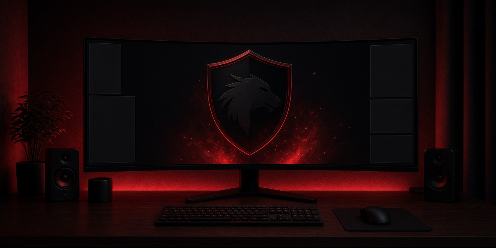

# Blackshield

Blackshield — an Omarchy post-install theme and ultrawide kit.

## Included

- Theme: colors, shell chrome, lock surface, wallpapers, icon name, EDID bin
- Shell: bar modules, plugins, branding, `shell.json`, brightness wrapper
- Cursor theme
- `hold-wide-mode` — re-asserts the ultrawide mode after lock and DPMS
- EDID installer — Limine drop-in and initramfs, never a copied `limine.conf`

## Requirements

Omarchy, already installed. `hold-wide-mode` needs Hyprland and `jq`. The EDID phase needs `sudo`, Limine entry drop-ins, and `mkinitcpio`.

## Install

```bash
git clone https://github.com/Blackshield-Company/omarchy-blackshield
cd omarchy-blackshield
./install.sh [phase]
```

Phases: `desktop` (default: theme, shell, cursor, fonts), `theme`, `shell`, `cursor`, `fonts`, `hold`, `edid`.

## EDID

Confirm the connector, then install. Reboot to apply.

```bash
OUTPUT=DP-1 ./install.sh edid --check
OUTPUT=DP-1 ./install.sh edid
```

`OUTPUT` defaults to `DP-2`. The script refuses to write a cmdline for a connector that is not plugged in. Do not edit `/boot/limine.conf`. See `docs/HARDWARE.md`.

## hold-wide-mode

```bash
./install.sh hold
```

| Variable | Default | Meaning |
|---|---|---|
| `OUTPUT` | `DP-2` | Connector name. Also the cursor `default_monitor`. |
| `DESC` | empty | Description substring. Empty matches by `OUTPUT` name. |
| `MODE` | `2560x1080@119.87` | Mode to re-assert. |
| `POS` | `auto` | Position. |
| `SCALE` | `1` | Scale. |

It does not touch the other output.

## Validate

```bash
./validate.sh
```

Static checks only. Does not install anything.

## Fonts

Kelmscott Mono is not in this repo. `./install.sh fonts` prints `fonts/KELMSCOTT-NOTICE.txt`. Install Kelmscott Mono from its source.

## Contact

blackshield@mail.grokbot.com

## Support

GitHub Sponsors: synthalorian. Ko-fi: synthalorian.

## License

Apache-2.0. See `LICENSE`.
